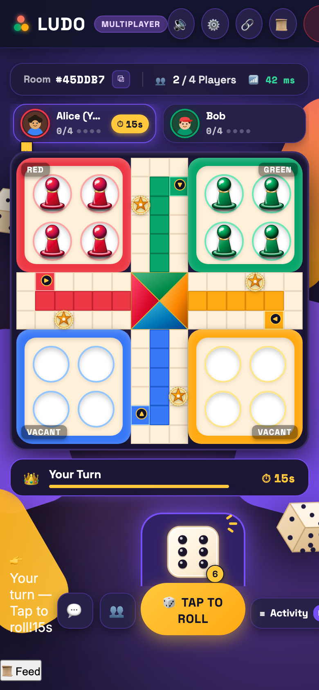
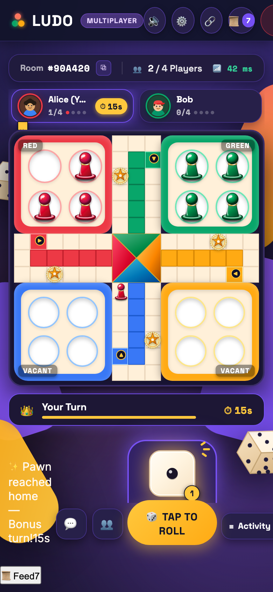
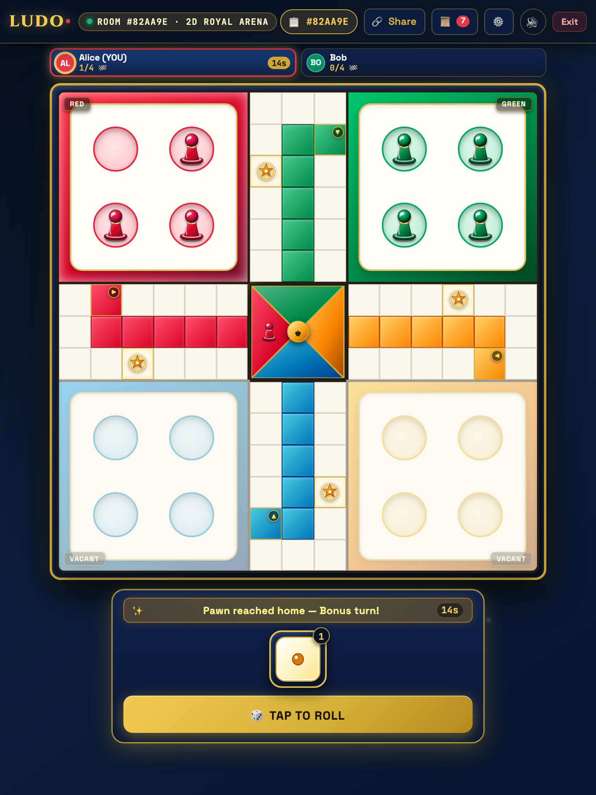
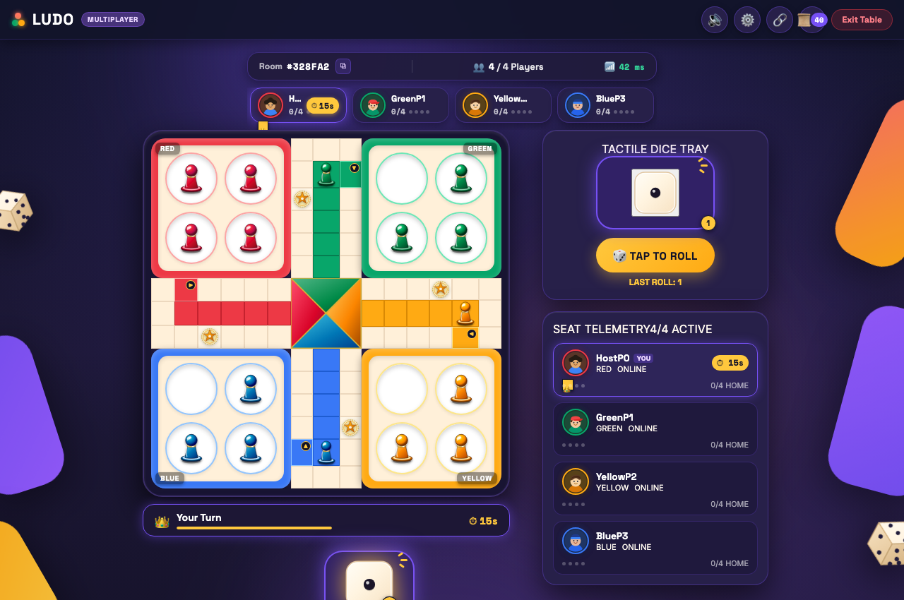
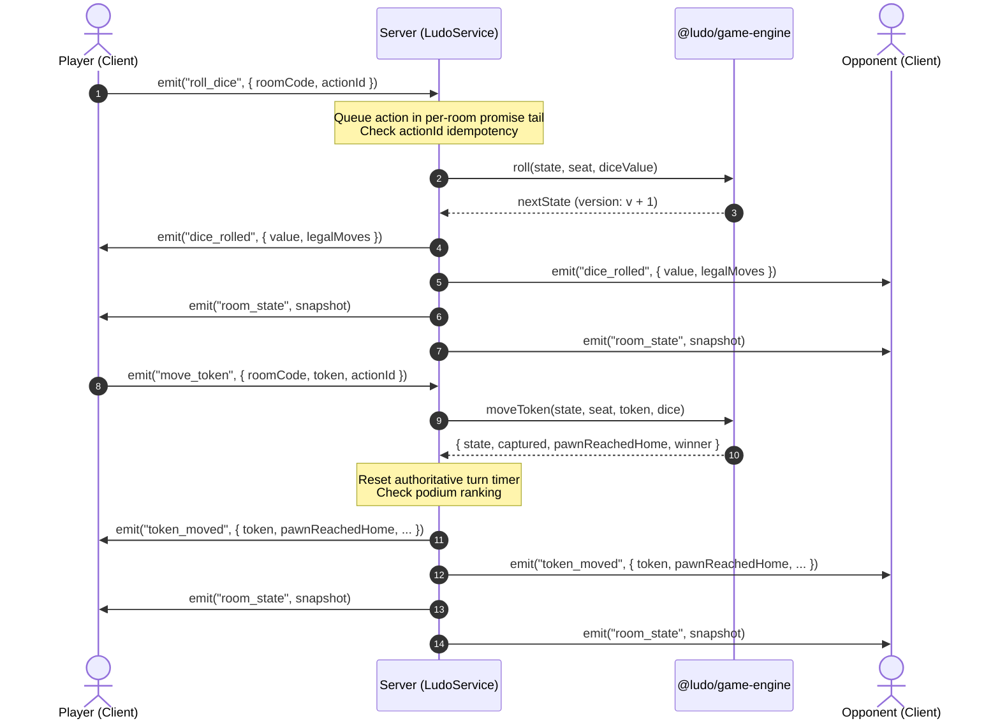

<div align="center">

# 🎲 LUDO ROYAL ARENA
### Real-Time Server-Authoritative Multiplayer Board Game

[](https://nodejs.org/)
[](https://www.typescriptlang.org/)
[](https://react.dev/)
[](https://socket.io/)
[](https://vitejs.dev/)
[](https://vitest.dev/)
[](https://playwright.dev/)
[](LICENSE)

<p align="center">
  A zero-budget, production-ready, server-authoritative multiplayer Ludo game designed with a mobile-first philosophy, royal navy-and-gold aesthetics, traditional enamel pawn styling, smooth GPU movement animations, and deterministic netcode.
</p>

[Key Features](#-key-features) •
[Architecture](#-repository-architecture) •
[Quick Start](#-quick-start) •
[Netcode & Synchronization](#-state-synchronization--netcode) •
[Testing & QA](#-testing--qa-verification) •
[Deployment](#-production-deployment) •
[Documentation](#-technical-audits--documentation)

---

</div>

## 📸 Visual Showcase

<div align="center">

| Mobile Portrait (390×844) | Active Bonus Turn | Tablet Arena (768×1024) |
| :---: | :---: | :---: |
|  |  |  |

| Desktop 1080p Arena | Mobile Landscape (844×390) |
| :---: | :---: |
|  |  |

</div>

---

## ✨ Key Features

### 🎮 Gameplay & Authentic Ludo Rules
- **Server-Authoritative Dice & Movement**: All rolls and moves are validated and calculated strictly on the backend.
- **Mathematical Movement Precision**: Exact movement calculation ($\Delta \text{progress} = \text{dice}$) across all 52 circuit cells and 6 home-lane steps.
- **Home Runway & Exact Center Finish**: Pawns complete a full circuit and transition smoothly into their respective colored home runway, requiring an exact roll to enter the Center Goal.
- **Capture & Finishing Bonus Turns**:
  - Capturing an opponent pawn sends it back to the base socket and awards an extra turn.
  - Bringing an individual pawn home into the Center Goal (`progress === 6`) immediately awards a bonus turn (*"Pawn reached home — Bonus turn!"*).
- **Two-Winner Match Lifecycle**:
  - **2-Player Matches**: Conclude immediately when the first player brings all 4 pawns home.
  - **3-Player & 4-Player Matches**: The game continues seamlessly after 1st place finishes and only concludes when 2nd place achieves victory. Finished players are ranked on the victory podium and safely removed from active turn rotation.
- **Configurable Turn Timer**: Automatic turn passing/forfeiture when the countdown timer expires, skipping vacant or disconnected seats.

### 🎨 Visual & Interaction Design
- **Royal Navy & Gold Visual Identity**: Elegant, dark-mode board design with high-contrast colored track routes (Red, Green, Yellow, Blue) and glowing safe star cells.
- **Traditional Enamel Ludo Pawns**: Custom SVG tokens featuring tiered circular pedestals, glossy enamel highlights, and realistic ground contact drop shadows.
- **Continuous Movement Interpolation**: Waypoint hopping utilizes continuous linear CSS position transitions (`left, top 115ms linear`) paired with subtle vertical bounce keyframes (`translateY(-8px)`), eliminating DOM position jitter.
- **Dynamic Deployment & Return Animations**: Smooth 3-point parabolic launch arc when deploying from base sockets, and rapid spinning return arcs upon capture.
- **Mobile-First Ergonomics**: Purpose-built mobile interface with a unified thumb-reachable control card, 74px tactile dice tray, rolling tumble animation, and prominent "TAP TO ROLL" action triggers.
- **Integrated Audio Engine**: Synthesized and tactile sound design for rolling, hopping, capturing, safe-landing, timeout warnings, and podium victory.

### 🔒 Enterprise-Grade Netcode
- **Monotonic State Versioning**: Every state transition increments an authoritative version number ($v_{t+1} = v_t + 1$) preserved across rematches.
- **Per-Room Action Serialization**: Asynchronous promise tail (`actionTail`) guarantees atomic action execution without race conditions.
- **Idempotent Action Deduplication**: Unique client `actionId` tagging suppresses duplicate network requests.
- **State Recovery & Reconnection**: Automatic snapshot synchronization (`request_game_state`) recovers interrupted sessions without room resets.
- **Pluggable Persistence**: Dual-mode engine supports zero-config in-memory operations for development and PostgreSQL / Supabase connection pooling for production.

---

## 🏛️ Repository Architecture

This project is structured as a **pnpm monorepo** in the `ludo/` workspace:

```text
.
├── README.md                      # Main project documentation & visual guide
├── DEPLOYMENT.md                  # Complete step-by-step production deployment guide
├── render.yaml                    # Infrastructure-as-code blueprint for Render
├── docs/                          # Comprehensive audits, architecture & screenshot archives
│   ├── quality-of-life-audit.md   # QoL Update 2 audit (Movement, Bonus turns, 2-winner lifecycle)
│   ├── gameplay-animation-audit.md# Comprehensive animation & home lane audit report
│   ├── game-rules-audit.md        # Engine rules verification & mathematical audit
│   └── mobile_screenshots/        # High-resolution real gameplay captures across viewports
└── ludo/                          # Single Source of Truth Monorepo
    ├── pnpm-workspace.yaml        # Monorepo workspace configuration
    ├── package.json               # Monorepo root scripts & dev dependencies
    ├── packages/
    │   └── game-engine/           # Pure TypeScript deterministic Ludo rules engine
    │       ├── src/index.ts       # Board math, legal moves, state transitions & rankings
    │       └── test/              # 48 unit tests (rules, home-lane, quality-of-life)
    └── apps/
        ├── server/                # Node.js + Express + Socket.IO authoritative server
        │   ├── src/               # Game server, room manager, timer & persistence
        │   └── test/              # 26 integration tests + Playwright real multiplayer E2E
        └── web/                   # Mobile-first React 18 + Vite frontend
            ├── src/               # Board2D, PawnToken, DiceRoller, AudioEngine, main UI
            └── dist/              # Production static client bundle
```

### Monorepo Packages
| Package | Role | Key Technologies |
| :--- | :--- | :--- |
| **`@ludo/game-engine`** | Pure, deterministic game logic and rules | TypeScript, Vitest |
| **`@ludo/server`** | Authoritative WebSocket & REST backend | Node.js, Express, Socket.IO, PostgreSQL / Supabase, Zod |
| **`@ludo/web`** | Responsive, mobile-first client application | React 18, Vite, SVG/CSS3 hardware acceleration, Web Audio |

---

## 🚀 Quick Start

### Prerequisites
- **Node.js**: `>= 24.x LTS` (verified on v24.22.3)
- **pnpm**: `>= 9.x`
- **PostgreSQL** *(Optional)*: Supabase or local PostgreSQL instance (in-memory mode used by default)

### 1. Installation
Clone the repository and install all workspace dependencies:
```bash
git clone https://github.com/Jarjis-Alam/ludo-3d-multiplayer.git
cd "Build a Real-Time Multiplayer 3D Ludo Game"
pnpm --dir ludo install
```

### 2. Build Monorepo
Compile the game engine, client bundle, and server:
```bash
pnpm build
```

### 3. Launch Development Servers
Start both the backend server and frontend client concurrently:
```bash
pnpm dev
```
* **Frontend Client**: `http://localhost:5173`
* **Backend Server**: `http://localhost:3001`
* **Health Check Endpoint**: `http://localhost:3001/health`

Open `http://localhost:5173` in multiple browser tabs or devices on your local network to test real-time multiplayer gameplay.

---

## 🧪 Testing & QA Verification

The codebase maintains rigorous automated test coverage across unit, integration, simulation, and real end-to-end browser environments.

```bash
# 1. Run all pure game engine unit tests (48 tests)
pnpm test:engine

# 2. Run server integration, netcode sync & timer tests (26 tests)
pnpm test:server

# 3. Run the complete test suite across all monorepo packages (74 tests)
pnpm test:all

# 4. Run real multiplayer Playwright E2E suite (Socket.IO + live browsers)
pnpm --dir ludo/apps/server exec tsx test/e2e-quality-of-life.mts

# 5. Run 20-match Monte Carlo simulation with PRNG seeds
pnpm sim:20

# 6. Run multi-player dynamic turn rotation QA suite (2, 3 & 4 players)
pnpm qa:players
```

### Test Suite Highlights
- **Engine Rules Verification**: Tests pawn deployment on 6, consecutive-six penalties, safe cell immunity, capture mechanics, home entry calculations, exact finish requirements, and bonus turn grants.
- **Multiplayer Turn Sync**: Tests turn passing, timeout forfeiture, reconnect state preservation, and monotonic state versioning across rematches.
- **Playwright End-to-End**: Spins up an actual Socket.IO server and static client to simulate real players rolling, moving, entering home runways, and reaching the podium.

---

## 🔒 State Synchronization & Netcode



1. **Deterministic State Invariance**: Game logic in `@ludo/game-engine` is purely functional without side effects.
2. **Action Queue (`actionTail`)**: Eliminates race conditions by chaining mutations into a per-room FIFO promise queue.
3. **Monotonic Version Increment**: Every mutation increments `state.version`. Clients sending an out-of-order `expectedVersion` are rejected and resynchronized.
4. **Authoritative Timers**: Server controls turn deadlines with automatic fallback when turns expire.

---

## 🌐 Production Deployment

The project is designed for zero-cost deployment using industry-standard platforms:

```text
┌────────────────────────┐      Persistent WebSockets      ┌────────────────────────┐
│      Vercel (SPA)      │ ◄─────────────────────────────► │     Render (Server)    │
│  React 18 + Vite Web   │                                 │ Node.js + Socket.IO    │
└────────────────────────┘                                 └───────────┬────────────┘
                                                                       │ SSL Pooler
                                                           ┌───────────▼────────────┐
                                                           │   Supabase (PostgreSQL)│
                                                           │   Room & Session State │
                                                           └────────────────────────┘
```

1. **Frontend (Vercel)**:
   - Root directory: `ludo/apps/web`
   - Build command: `pnpm build`
   - Output directory: `dist`
   - Environment variable: `VITE_SERVER_URL=https://<your-render-backend>.onrender.com`
2. **Backend (Render)**:
   - Deployed via the included `render.yaml` blueprint with persistent WebSocket support enabled.
   - Environment variables: `NODE_ENV=production`, `PORT=10000`, `CLIENT_ORIGIN=https://<your-vercel-app>.vercel.app`, `DATABASE_URL=<supabase_pooler_uri>`.
3. **Database (Supabase PostgreSQL)**:
   - Free-tier PostgreSQL database using Transaction Pooler port (`6543`) with SSL enabled.

*For complete step-by-step instructions, see [DEPLOYMENT.md](file:///Users/munshijarjisalam/Documents/Projects/Build%20a%20Real-Time%20Multiplayer%203D%20Ludo%20Game/DEPLOYMENT.md).*

---

## 📚 Technical Audits & Documentation

Detailed engineering reports and audits documenting the game's evolution:
- [**Quality of Life Update 2 Audit**](file:///Users/munshijarjisalam/Documents/Projects/Build%20a%20Real-Time%20Multiplayer%203D%20Ludo%20Game/docs/quality-of-life-audit.md): Deep dive into movement interpolation, bonus turn mechanics, and multi-winner lifecycle implementation.
- [**Gameplay & Animation Audit**](file:///Users/munshijarjisalam/Documents/Projects/Build%20a%20Real-Time%20Multiplayer%203D%20Ludo%20Game/docs/gameplay-animation-audit.md): Complete audit of home-lane transitions across Red, Green, Yellow, and Blue with live Playwright verification.
- [**Game Rules Engine Audit**](file:///Users/munshijarjisalam/Documents/Projects/Build%20a%20Real-Time%20Multiplayer%203D%20Ludo%20Game/docs/game-rules-audit.md): Mathematical correctness of coordinate mapping, safe cells, turn timer forfeiture, and dynamic seat rotation.
- [**Production Deployment Guide**](file:///Users/munshijarjisalam/Documents/Projects/Build%20a%20Real-Time%20Multiplayer%203D%20Ludo%20Game/DEPLOYMENT.md): Step-by-step instructions for Vercel, Render, and Supabase deployment.

---

## 📄 License

This project is licensed under the MIT License — see the [LICENSE](LICENSE) file for details.
