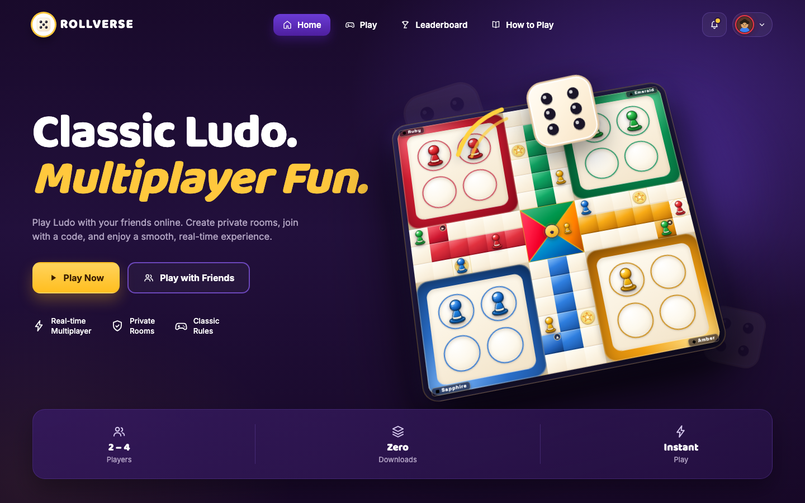
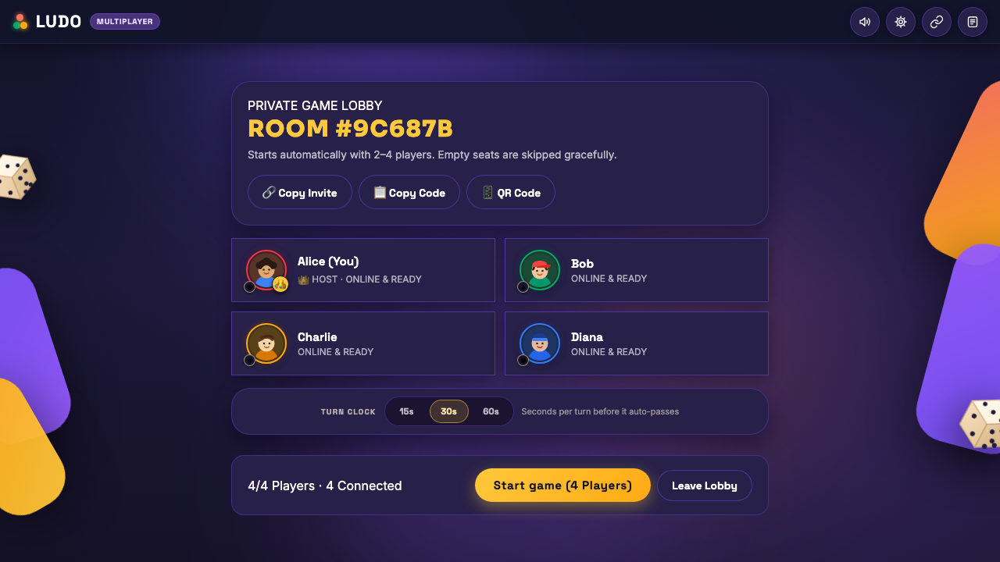
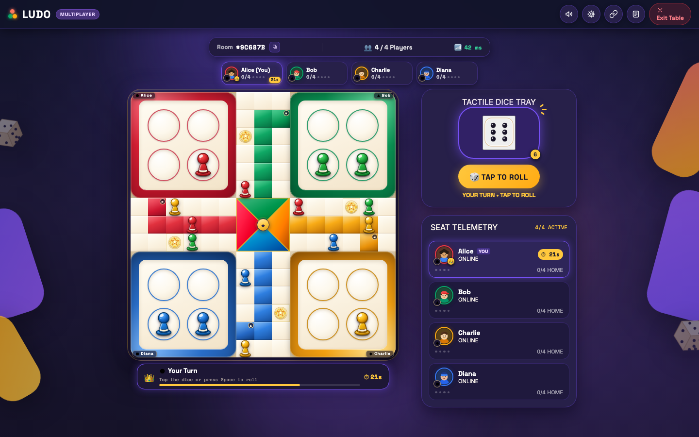
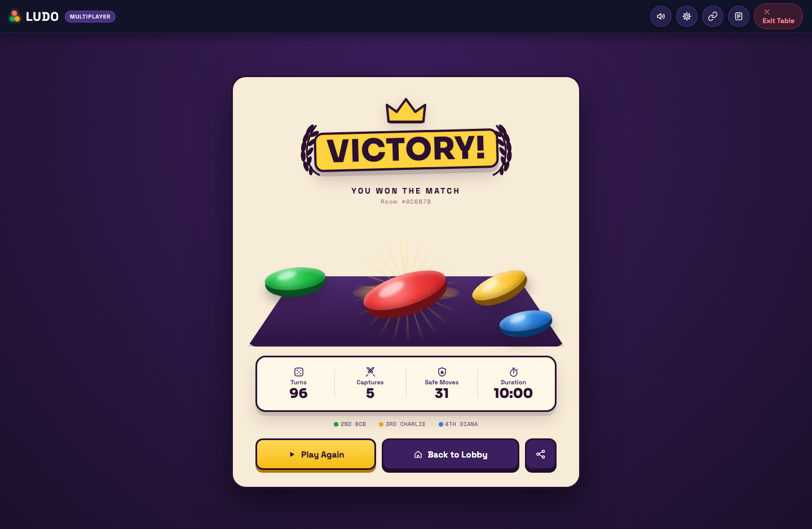
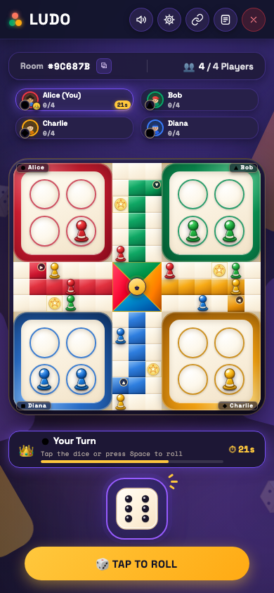
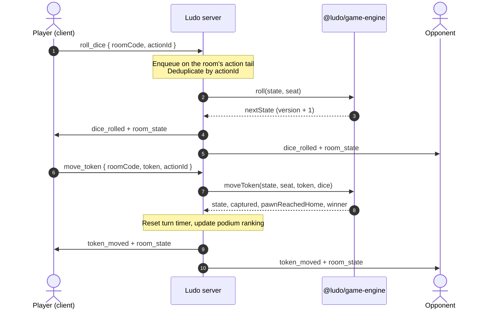

<div align="center">

# Ludo Royal Arena

**A real-time, server-authoritative multiplayer Ludo game for private tables**

[](https://nodejs.org/)
[](https://www.typescriptlang.org/)
[](https://react.dev/)
[](https://socket.io/)
[](https://vitejs.dev/)
[](https://vitest.dev/)
[](LICENSE)

</div>

---

## Overview

Ludo Royal Arena is a pnpm monorepo containing a deterministic Ludo rules engine, an authoritative Socket.IO server and a React client. One player creates a table, shares a six-character room code or QR invite, and the match starts once at least two of the four seats are filled. Every dice roll, move, capture and finish is validated on the server; clients render only confirmed state.

| Capability | Implementation |
| :--- | :--- |
| Authoritative rules | Rolls and moves are produced and validated by `@ludo/game-engine` on the server |
| Concurrency safety | Per-room FIFO action queue, idempotent `actionId` handling, monotonic state versions |
| Session recovery | Snapshot resynchronisation after a reconnect; optional persistent sessions when `DATABASE_URL` is set |
| Match lifecycle | 2-player matches end on the first finish; 3–4 player matches end when second place finishes |
| Persistence | In-memory by default; PostgreSQL when `DATABASE_URL` is present |
| Presentation | Responsive landing, lobby, match and victory screens with tactile audio and haptics |

## Screenshots

| Homepage (1440×900) | Lobby (1280×720) |
| :---: | :---: |
|  |  |

| Desktop match (1440×900) | Victory (1440×940) |
| :---: | :---: |
|  |  |

<p align="center">
  
</p>

## Features

### Gameplay

- **Server-authoritative dice and movement** — clients request an action; the server rolls, validates and broadcasts the resulting state.
- **Full Ludo movement model** — a 52-cell circuit, six home-lane steps per colour, safe cells, captures and the exact roll needed to reach the centre goal.
- **Bonus turns** — capturing an opponent pawn or bringing a pawn home grants an extra turn.
- **Configurable turn clock** — 15 s / 30 s / 60 s (host-selectable, default 30 s) with authoritative timeout forfeiture and automatic play when only one move is legal.
- **Ranked multi-winner lifecycle** — finished players leave the turn rotation and take a podium place.

### Interface

- **Neo Arcade design system** — midnight navy, violet and gold palette, inline SVG chrome, safe-area handling from 320 px phones to 1440 px desktops.
- **Guided entry flow** — board preview on the landing page, create/join sheets, room code copy and QR invite.
- **Stable match layout** — the board keeps a fixed square footprint while turn text, timers and dice results change around it.
- **Tactile controls and accessibility** — elevated dice tray, prominent roll action, animated pawn flights, reduced-motion mode, sound/haptic toggles and live-region turn announcements.

### Engineering

- **Deterministic engine** — a pure TypeScript reducer with no side effects, covered by unit tests.
- **Serialised room mutations** — every action runs through a promise tail, so concurrent events cannot interleave.
- **Versioned snapshots** — stale or duplicate client actions are rejected and resynchronised.
- **Optional PostgreSQL persistence** — rooms and guest sessions are reloaded on boot when a database is configured.
- **Playwright audits** — layout, mobile scrolling and end-to-end match scripts live in `ludo/apps/server/test/`.

## Architecture

```text
.
├── docs/                     # Audits and the curated screenshot set
├── ludo/                     # Application workspace (pnpm)
│   ├── packages/game-engine/ # Rules engine + unit tests
│   └── apps/
│       ├── server/           # Express + Socket.IO API, rooms, persistence, test suites
│       └── web/              # React 18 + Vite client
├── render.yaml               # Render blueprint for the API
├── vercel.json               # Vercel configuration for the client (repository root project)
└── DEPLOYMENT.md             # Production walkthrough
```

| Package | Role | Key technologies |
| :--- | :--- | :--- |
| `@ludo/game-engine` | Pure rules, legal moves, state transitions, rankings | TypeScript, Vitest |
| `@ludo/server` | Authoritative realtime API and persistence | Node.js, Express, Socket.IO, Zod, PostgreSQL |
| `@ludo/web` | Responsive game client and design system | React 18, Vite, CSS, Web Audio |

### State synchronisation



1. **Deterministic state** — identical inputs always produce identical state.
2. **Serialised mutations** — an action tail chains room mutations to remove races.
3. **Monotonic versions** — every mutation increments `state.version`; stale clients resynchronise.
4. **Authoritative timers** — the server owns turn deadlines and timeout forfeiture.

## Technology stack

| Layer | Choice |
| :--- | :--- |
| Runtime | Node.js 24 LTS (tested on 24.22.3) |
| Language | TypeScript 5.6 |
| Client | React 18.3, Vite 5.4, hand-written CSS design system |
| Realtime | Socket.IO 4.8 (server and client) |
| API | Express 4, Zod validation |
| Persistence | PostgreSQL 15+ via `pg`; in-memory fallback |
| Tests | Vitest 2.1 (unit/integration), Playwright (browser audits) |
| Tooling | pnpm 9.15 workspaces |

## Getting started

### Prerequisites

- Node.js 24.x LTS
- pnpm 9.x (`corepack enable` is the simplest way to match `packageManager: pnpm@9.15.0`)
- PostgreSQL — optional; the server keeps rooms in memory when `DATABASE_URL` is absent

### Install and run

```bash
git clone https://github.com/Jarjis-Alam/ludo-3d-multiplayer.git
cd ludo-3d-multiplayer

pnpm --dir ludo install
pnpm dev
```

| Service | URL |
| :--- | :--- |
| Web client | http://localhost:5173 |
| Realtime API | http://localhost:3001 |
| Health check | http://localhost:3001/health |

Open the client in two or more tabs, or on two devices on the same network, to play a real match. The Vite dev server binds to `0.0.0.0`, so a phone on the same Wi-Fi can join at `http://<your-lan-ip>:5173` once `VITE_SERVER_URL` points at `http://<your-lan-ip>:3001`.

### Production build

```bash
pnpm build
```

This builds the engine, the server (`ludo/apps/server/dist`) and the client (`ludo/apps/web/dist`).

## Environment variables

The server reads the process environment; it does not load `.env` files itself. Export the variables in your shell, or set them in your hosting provider's dashboard. [`.env.example`](.env.example) documents every variable.

| Variable | Used by | Required | Description |
| :--- | :--- | :---: | :--- |
| `PORT` | Server | No | HTTP/WebSocket port (default `3001`). |
| `CLIENT_ORIGIN` | Server | Production | Exact allowed frontend origin(s), comma-separated. `*` is rejected when `NODE_ENV=production`. |
| `DATABASE_URL` | Server | No | PostgreSQL connection string. Omit for in-memory rooms. |
| `SESSION_SECRET` | Server | Production | HMAC key for session-token hashes, at least 32 characters. Production refuses to start without it; development falls back to an ephemeral key. |
| `VITE_SERVER_URL` | Web build | Production | Public URL of the realtime API. Defaults to `http://localhost:3001`. |
| `LUDO_ARTIFACT_DIR` | Test scripts | No | Where Playwright audits write screenshots (defaults to `docs/artifacts`, which is git-ignored). |

## Testing

Verified on this revision: `pnpm build` succeeds and `pnpm test:all` reports **85 passing tests** — 48 engine rules tests (3 files) and 37 server integration, netcode, turn-clock, auto-play and persistence tests (7 files). Nothing is mocked at the protocol level: server tests drive real Socket.IO clients.

```bash
pnpm test:engine     # engine rules (48 tests)
pnpm test:server     # server integration and netcode (37 tests)
pnpm test:all        # both suites (85 tests)
```

Browser-level scripts require a production build and, for Playwright, one browser install:

```bash
pnpm --dir ludo exec playwright install chromium

# Every Playwright audit against the current landing page, lobby, match and victory screens
pnpm --dir ludo --filter @ludo/server test:audits

# Responsive layout audit over 8 viewports (writes captures to docs/layout-qa/after)
pnpm --dir ludo --filter @ludo/server test:visual

# Mobile scrolling and modal scroll-lock audit
pnpm --dir ludo --filter @ludo/server exec tsx test/verify-mobile-scroll.mts

# Two real browser clients playing a full match over Socket.IO
pnpm --dir ludo --filter @ludo/server exec tsx test/e2e-quality-of-life.mts

# 2 / 3 / 4-player rotation and lifecycle checks
pnpm qa:players

# 20 seeded simulated matches
pnpm sim:20
```

The seven audits behind `test:audits` (homepage, 8-viewport rendered geometry, modals and viewports, mobile polish, quality of life, real multiplayer home lanes) were run against this revision and pass. [STATUS.md](STATUS.md) records each audit's scope and result, together with the scripts that were not re-run.

## Deployment

Reference topology: a static client on Vercel, the Node.js realtime service on Render, and optional PostgreSQL on Supabase. Full walkthrough in [DEPLOYMENT.md](DEPLOYMENT.md).

| File | Use when |
| :--- | :--- |
| `vercel.json` (root) | **Canonical** Vercel project rooted at the repository root. |
| `ludo/vercel.json` | Only if the Vercel project root is the `ludo/` folder. |
| `ludo/apps/web/vercel.json` | Only if the Vercel project root is `ludo/apps/web`; the root layout above is preferred. |
| `render.yaml` | **Canonical** Render blueprint (`node ludo/apps/server/dist/index.js`, health check `/health`). |

Production requires `NODE_ENV=production`, `CLIENT_ORIGIN`, `VITE_SERVER_URL` and a `SESSION_SECRET` of at least 32 characters. `render.yaml` generates the secret for you; keep it stable across deploys.

## Known limitations

- Rooms live in a single server process; there is no multi-instance room coordination or sticky-session clustering.
- Without `DATABASE_URL`, restarting the API drops rooms and sessions.
- Identity is a guest session token — there are no accounts, profiles or cross-device logins.
- No in-match chat, spectator mode or global leaderboard (the landing page's leaderboard entry is a placeholder sheet).
- Browser coverage: Chrome/Safari desktop plus manual checks on one physical iPhone. No automated cross-browser matrix yet.
- Bundle size: the client is a single ~280 kB JS chunk (87 kB gzip) plus Socket.IO; there is no route-level code splitting.

See [STATUS.md](STATUS.md) for the verification history behind these notes.

## Documentation

| Document | Contents |
| :--- | :--- |
| [STATUS.md](STATUS.md) | Current engineering status, verified checks and open limitations |
| [DEPLOYMENT.md](DEPLOYMENT.md) | Vercel, Render and Supabase setup, post-deploy checks, free-tier behaviour |
| [Game Rules Audit](docs/game-rules-audit.md) | Board mathematics, safe cells, home lanes, finish rules |
| [Gameplay & Animation Audit](docs/gameplay-animation-audit.md) | Movement interpolation and home-lane verification |
| [Quality of Life Audit](docs/quality-of-life-audit.md) | Bonus turns, two-winner lifecycle, movement polish |
| [Mobile UX Audit](ludo/docs/mobile-ux-audit.md) | Viewport matrix, touch targets, square-board checks |
| [UI/UX Redesign Docs](docs/ui-ux-redesign/) | Product overview, screen inventory, journeys, responsive requirements |
| [Workspace README](ludo/README.md) | Package-level scripts and workspace layout |

## License

[MIT](LICENSE) © 2026 Jarjis Alam.

You may use, modify and redistribute this code, including commercially, provided the copyright notice
and permission notice in [LICENSE](LICENSE) are kept with it. The software is provided without warranty.

Third-party dependencies keep their own licences; see their packages for details.
