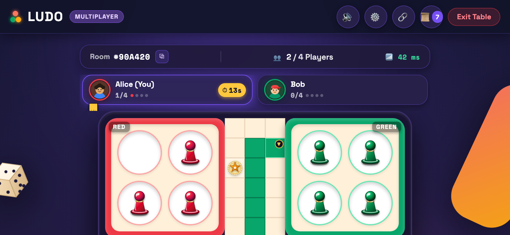
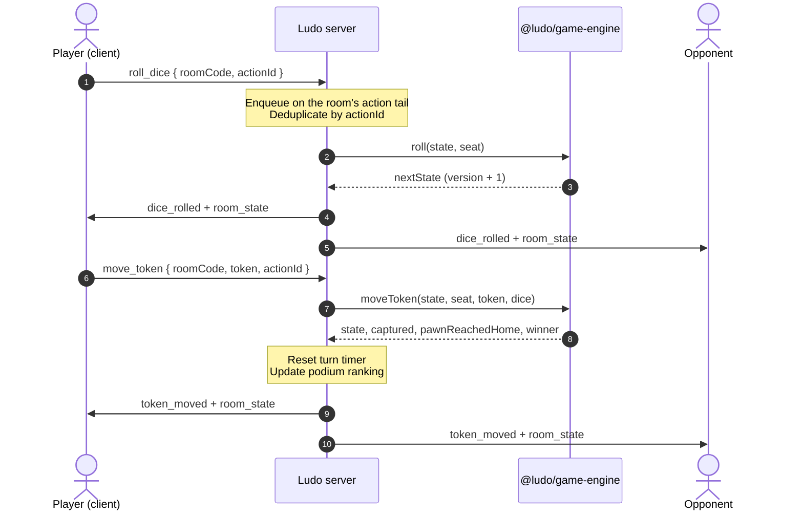

<div align="center">

# LUDO ROYAL ARENA

**A real-time, server-authoritative multiplayer Ludo game**

[](https://nodejs.org/)
[](https://www.typescriptlang.org/)
[](https://react.dev/)
[](https://socket.io/)
[](https://vitejs.dev/)
[](https://vitest.dev/)
[](https://playwright.dev/)
[](https://opensource.org/licenses/MIT)

A zero-install, private-table Ludo experience for 2–4 players. Every dice roll, move, capture and finish is validated on the server; the client is a responsive, mobile-first interface built around a midnight-violet “Neo Arcade” design system.

[Quick Start](#quick-start) · [Architecture](#architecture) · [Testing & QA](#testing--qa) · [Netcode](#state-synchronisation) · [Deployment](#deployment) · [Documentation](#documentation)

</div>

---

## Overview

Ludo Royal Arena is a pnpm monorepo with a deterministic rules engine, an authoritative Socket.IO server, and a React client. It is designed for private matches: one player creates a table, shares a six-character room code or QR invite, and the match starts automatically once at least two players have joined.

| Capability | Implementation |
| :--- | :--- |
| Authoritative rules | All rolls and moves are produced and validated by `@ludo/game-engine` on the server |
| Concurrency safety | Per-room FIFO action queue, idempotent `actionId` handling, monotonic state versions |
| Session recovery | Snapshot resynchronisation after reconnects; no room reset required |
| Match lifecycle | 2-player matches end on the first finish; 3–4 player matches end when second place finishes |
| Persistence | In-memory by default; PostgreSQL / Supabase when `DATABASE_URL` is present |
| Presentation | Responsive landing, lobby, match and victory screens with tactile audio and haptics |

---

## Visual Showcase

<div align="center">

| Mobile Match (390×844) | Bonus Turn | Tablet Match (768×1024) |
| :---: | :---: | :---: |
|  |  |  |

| Desktop Match (1080p) | Mobile Landscape |
| :---: | :---: |
|  |  |

</div>

---

## Features

### Gameplay

- **Server-authoritative dice and movement** — clients request an action; the server rolls, validates and broadcasts the resulting state.
- **Exact movement mathematics** — progress advances by the rolled value across the 52-cell circuit and six home-lane steps.
- **Home lane and exact finish** — pawns enter their colour’s runway after a full circuit and need the exact roll to reach the centre goal.
- **Bonus turns** — capturing an opponent pawn or bringing a pawn home grants an extra turn.
- **Configurable turn timer** — defaults to 30 seconds with a host-only 15s / 30s / 60s lobby selector that persists across joins, leaves and rematches; expired turns are forfeited server-side.
- **Ranked multi-winner lifecycle** — finished players are removed from turn rotation and placed on the podium.

### Interface

- **Neo Arcade design system** — midnight navy, electric violet and gold tokens with a shared spacing scale, inline SVG chrome and mobile safe-area handling.
- **Streamlined entry flow** — animated 15×15 tabletop board preview, modal create/join entry sheets (`Play Now` / `Play with Friends`), and `How to Play` / `Leaderboard` info sheets.
- **Responsive by construction** — tuned from 320 px phones through 1440 px desktops (including landscape), with a `+N open` invite trigger on the room bar and frame-aligned yard name plates clear of token sockets.
- **Predictable mobile scrolling** — single document-root scroll context (`overflow-x: clip`), clipped background decorations (`.bg-decor-layer`), and reference-counted scroll locking (`scrollLock.ts`) for modals and drawers.
- **Tactile controls and accessibility** — elevated dice tray, prominent roll action, animated pawn interpolation, reduced-motion mode, sound/haptic toggles and live-region status announcements.
- **Share and activity tools** — room code copy, QR invites, and a match activity drawer.

### Engineering

- **Deterministic engine** — pure TypeScript rules module with no side effects, covered by unit tests.
- **Atomic room actions** — a promise tail serialises every mutation so concurrent events cannot interleave.
- **Versioned snapshots** — out-of-order or duplicate client actions are rejected and resynchronised.
- **Optional PostgreSQL persistence** — connection-pooled storage for room and session state in production.
- **Visual regression layer** — Playwright geometry audits assert real rendered layout, not only overflow widths.

---

## Architecture

```text
.
├── README.md                     # Project overview (this file)
├── DEPLOYMENT.md                 # Step-by-step production deployment guide
├── render.yaml                   # Render infrastructure blueprint for the API
├── vercel.json                   # Vercel configuration for the client
├── docs/                         # Audits, screenshots and layout QA captures
│   ├── layout-qa/                # Before/after captures from the visual audit
│   ├── mobile_screenshots/       # Real gameplay captures across viewports
│   ├── screenshots/              # Desktop gameplay and home-lane captures
│   └── *.md                      # Rules, animation and quality-of-life audits
└── ludo/                         # Monorepo workspace
    ├── packages/game-engine/     # Deterministic Ludo rules engine + unit tests
    └── apps/
        ├── server/               # Express + Socket.IO API, room manager, persistence
        │   └── test/             # Integration, netcode, simulation and Playwright suites
        └── web/                  # React 18 + Vite client and design system
```

| Package | Role | Key technologies |
| :--- | :--- | :--- |
| `@ludo/game-engine` | Pure rules, legal moves, state transitions, rankings | TypeScript, Vitest |
| `@ludo/server` | Authoritative realtime API and persistence | Node.js, Express, Socket.IO, Zod, PostgreSQL |
| `@ludo/web` | Responsive game client and design system | React 18, Vite, CSS, Web Audio |

---

## Quick Start

### Prerequisites

- **Node.js 24.x LTS** (verified on 24.22.3)
- **pnpm 9.x** (pinned to 9.15.0)
- **PostgreSQL** — optional; the server uses in-memory persistence when `DATABASE_URL` is absent

### Install and run

```bash
git clone https://github.com/Jarjis-Alam/ludo-3d-multiplayer.git
cd ludo-3d-multiplayer

pnpm --dir ludo install
pnpm dev
```

| Service | URL |
| :--- | :--- |
| Web client | http://localhost:5173 |
| Realtime API | http://localhost:3001 |
| Health check | http://localhost:3001/health |

Open the client in two or more tabs (or devices on the same network) to test a real match.

### Production build

```bash
pnpm build          # builds game-engine, web client and server
```

### Environment variables

The API and client read the following variables. For local development they can be exported in your shell; production deployments should set them in the hosting provider’s dashboard.

| Variable | Used by | Required | Description |
| :--- | :--- | :---: | :--- |
| `PORT` | Server | No | HTTP/WebSocket port (default `3001`). |
| `CLIENT_ORIGIN` | Server | Production | Exact allowed frontend origin. `*` is rejected in production. |
| `DATABASE_URL` | Server | No | PostgreSQL connection string. Enables persistent rooms; omit for in-memory mode. |
| `SESSION_SECRET` | Server | Production | HMAC secret used to hash session tokens. A development fallback is used when unset. |
| `VITE_SERVER_URL` | Web build | Production | Public URL of the realtime API. Defaults to `http://localhost:3001`. |

A reference file is provided at [`.env.example`](.env.example).

---

## Testing & QA

The project combines five complementary verification layers: pure engine tests, server integration and netcode tests, multiplayer simulations, real-browser end-to-end matches, and rendered-geometry visual audits.

```bash
# Install the Playwright browser once
pnpm --dir ludo exec playwright install chromium

# Rules engine — 48 unit tests
pnpm test:engine

# Server integration, netcode, turn clock and persistence — 29 tests
pnpm test:server

# Everything — 77 tests across the workspace
pnpm test:all

# Mobile scrolling & modal lock audit (Playwright, 8 viewports)
pnpm --dir ludo --filter @ludo/server exec tsx test/verify-mobile-scroll.mts

# Responsive visual layout audit (Playwright, 8 viewports)
pnpm --dir ludo --filter @ludo/server test:visual

# Real multiplayer end-to-end match (Socket.IO + live browsers)
pnpm --dir ludo --filter @ludo/server exec tsx test/e2e-quality-of-life.mts

# 2 / 3 / 4-player rotation and lifecycle QA
pnpm qa:players

# 20 seeded Monte Carlo matches
pnpm sim:20
```

### Visual layout audit

`test:visual` renders the homepage, lobby, match and victory screens at **320×568, 360×800, 375×667, 390×844, 430×932, 800×1332, 1280×720 and 1440×900**. It performs over a thousand rendered-geometry assertions per run, including:

- text line boxes never intersecting floating decorations;
- buttons, inputs and board previews staying inside their parent panels;
- the board remaining square and fully contained;
- header, dock and podium controls staying on screen and not overlapping;
- screenshots of every audited screen written to `docs/layout-qa/after/`.

Capture examples are committed in [`docs/layout-qa/`](docs/layout-qa/).

### Test coverage summary

| Suite | Scope |
| :--- | :--- |
| Engine unit tests | Deployment, legal moves, captures, safe cells, home lanes, exact finish, rankings |
| Server integration | Room lifecycle, turn rotation, configurable turn timer, timeout forfeiture, reconnect resync, persistence |
| Simulations | Long-running seeded matches for rule and state-integrity regressions |
| Playwright E2E | Real browsers and Socket.IO clients playing complete matches |
| Mobile scroll audit | Document-root scroll (`verify-mobile-scroll.mts`), zero horizontal overflow, overlay scroll lock/restore across 8 viewports (`320×568` to `1280×720`) |
| Visual audit | Rendered layout, containment, decoration collisions and responsive screenshots |

---

## State Synchronisation



1. **Deterministic state** — the engine is a pure reducer; identical inputs always produce identical state.
2. **Serialised mutations** — `actionTail` chains room mutations to eliminate race conditions.
3. **Monotonic versions** — every mutation increments `state.version`; stale clients are resynchronised.
4. **Authoritative timers** — the server owns turn deadlines and applies timeout forfeiture.

---

## Deployment

The reference topology is a static client on Vercel, a Node.js realtime service on Render, and optional PostgreSQL on Supabase.

```text
┌────────────────────────┐      WebSockets       ┌────────────────────────┐
│      Vercel (SPA)      │ ◄───────────────────► │     Render (API)       │
│  React 18 + Vite web   │                       │ Node.js + Socket.IO    │
└────────────────────────┘                       └───────────┬────────────┘
                                                             │ SSL pooler
                                                 ┌───────────▼────────────┐
                                                 │ Supabase (PostgreSQL)  │
                                                 └────────────────────────┘
```

### Frontend — Vercel

Import the repository at its root; the committed [`vercel.json`](vercel.json) supplies the build and routing configuration.

| Setting | Value |
| :--- | :--- |
| Project root | Repository root |
| Build command | `pnpm --dir ludo --filter @ludo/game-engine build && pnpm --dir ludo --filter @ludo/web build` |
| Output directory | `ludo/apps/web/dist` |
| Environment variable | `VITE_SERVER_URL=https://<your-render-service>.onrender.com` |

Alternatively, point the Vercel project at `ludo/apps/web` and use its local `vercel.json` (`dist` output).

### Backend — Render

Deploy with the included [`render.yaml`](render.yaml) blueprint. It installs with a frozen lockfile, builds the engine and server, and starts `node ludo/apps/server/dist/index.js` with the `/health` check. Configure:

- `NODE_ENV=production`
- `PORT=10000`
- `CLIENT_ORIGIN=https://<your-vercel-app>.vercel.app`
- `DATABASE_URL=<supabase-pooler-connection-string>`
- `SESSION_SECRET` — generated by the blueprint; keep it stable across deploys

### Database — Supabase

Use the transaction pooler connection string (port `6543`) with SSL enabled. Without `DATABASE_URL`, the API runs in in-memory mode, which is suitable for development only. Restrict `CLIENT_ORIGIN` to the exact deployed frontend origin; the server refuses a wildcard origin in production.

See [DEPLOYMENT.md](DEPLOYMENT.md) for the complete walkthrough.

---

## Design System Notes

The interface uses the Neo Arcade token set in [`ludo/apps/web/src/style.css`](ludo/apps/web/src/style.css):

- **Surfaces:** midnight `#111329`, deep purple `#201B3B`, card `#272049`
- **Accents:** electric violet `#7650F5`, purple `#965BFF`, gold `#FFC83D`, coral `#FF765F`
- **Player colours:** red `#ED3945`, green `#08A66A`, yellow `#FFAA13`, blue `#3978F6`
- **Spacing:** 4 px base scale (`--space-1` … `--space-8`) with a shared page gutter
- **Breakpoints:** 960 px (single-column landing), 640 px (compact layout), 430 px (compact room bar), 360 px (tight header controls)

Decorative shapes and dice render inside `.bg-decor-layer` (`overflow: hidden; pointer-events: none`), while `html`, `body`, `.game-master-backdrop`, and `.victory-screen` use `overflow-x: clip` so mobile scrolling stays on the document root without nested scroll containers. Modals and the activity drawer share [`scrollLock.ts`](ludo/apps/web/src/scrollLock.ts) (`acquireScrollLock`) and restore page scroll cleanly across closures and screen transitions.

---

## Documentation

| Document | Contents |
| :--- | :--- |
| [DEPLOYMENT.md](DEPLOYMENT.md) | Vercel, Render and Supabase setup |
| [Game Rules Audit](docs/game-rules-audit.md) | Board mathematics, safe cells, home lanes, finish rules |
| [Gameplay & Animation Audit](docs/gameplay-animation-audit.md) | Movement interpolation and home-lane verification |
| [Quality of Life Audit](docs/quality-of-life-audit.md) | Bonus turns, two-winner lifecycle, movement polish |
| [UI/UX Redesign Docs](docs/ui-ux-redesign/) | Product overview, screen inventory, journeys, responsive requirements |
| [Layout QA Captures](docs/layout-qa/) | Before/after screenshots from the visual audit |
| [Monorepo README](ludo/README.md) | Package-level scripts and workspace layout |

---

## License

Released under the MIT License.
