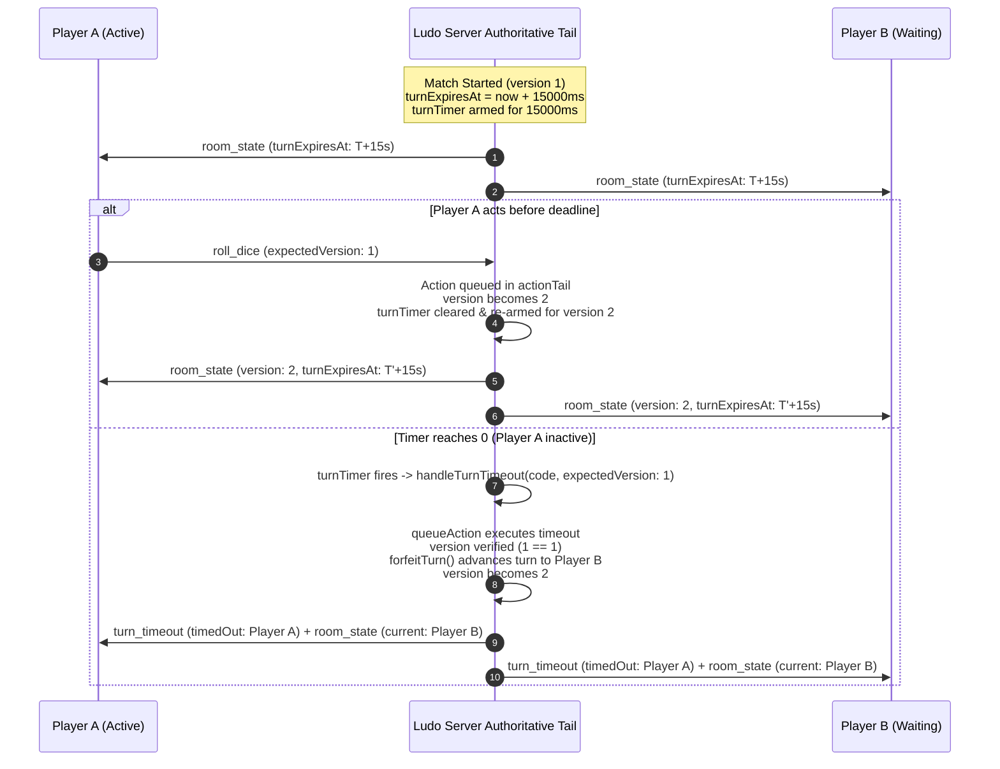

# Ludo Game Engine, Netcode & Rules Audit Report

**Date**: November 16, 2026  
**Auditor**: Antigravity Autonomous Systems Engineer  
**Scope**: Full stack (`@ludo/game-engine`, `@ludo/server`, `@ludo/web`, Socket.IO protocol, PostgreSQL persistence, and deterministic simulation suites).

---

## 1. Complete List of Rules Audited

The entire game engine and multiplayer lifecycle was audited against classic international Ludo standards:

1. **Player & Seat Allocation**:
   - 2, 3, and 4 player dynamic matchmaking.
   - Distinct color and seat mapping (Seat 0: Red, Seat 1: Green, Seat 2: Yellow, Seat 3: Blue).
   - Strict dynamic turn rotation skipping empty/vacant seats.
   - Host authorization and starting requirements (minimum 2 connected human players).
2. **Dice Authoritative Mechanics**:
   - Cryptographically random server generation (`crypto.randomInt(1, 7)`).
   - Value validity check ($1 \le \text{dice} \le 6$).
   - Requirement of a 6 to release a token from home yard onto starting cell.
   - Single roll yielding a 6 awards an extra roll after moving.
   - Three consecutive sixes penalty (forfeits turn immediately with move revoked).
   - Automatic turn passing when no legal moves exist.
3. **Token Movement & Track Geometry**:
   - 4 tokens per player initialized in home yard (`kind: 'base'`).
   - Starting offsets ($[0, 13, 26, 39]$) mapped onto shared 52-cell cyclical track.
   - Unidirectional forward progression strictly equal to rolled dice value.
   - Entry into player-specific isolated home runway (5 cells leading to final Goal cell 6).
   - Exact roll required to land on Goal cell (progress 6).
   - Prohibition of overshooting the final Goal cell.
   - Finished pawns permanently locked from moving.
4. **Pawn Captures**:
   - Landing on an opponent's token on a non-safe cell captures it.
   - Captured token returned immediately to owner's base socket.
   - Prohibition against capturing one's own tokens (co-occupancy permitted).
   - Multiple opponent tokens on a single non-safe cell handled correctly.
5. **Sanctuary & Safe Cells**:
   - 8 standard safe cells verified: starting pads ($0, 13, 26, 39$) and star sanctuary cells ($8, 21, 34, 47$).
   - Tokens on safe cells immune to capture.
6. **Victory Detection & Game Termination**:
   - Declaring victory only when all 4 tokens reach exact home Goal position (`kind: 'home'`, `progress: 6`).
   - Rejection of all further move/roll actions once a match is finished.
7. **Turn Timer & Forfeit Progression**:
   - Server-authoritative turn deadline (`turnExpiresAt`).
   - Automatic turn forfeit if player fails to roll within deadline.
   - Automatic turn forfeit if player rolls but fails to select a legal token within deadline.
   - Disconnected and vacant seats skipped upon forfeit.

---

## 2. Rules That Were Already Correct

Prior to this audit, the core geometric and rule-validation code in `packages/game-engine/src/index.ts` had several sound implementations:
- **Starting offsets and cyclical path math**: `absoluteCell(player, progress) = (START_OFFSETS[player] + progress) % PATH_LENGTH` mapped correctly onto the 52-cell track without indexing errors.
- **Base deployment on 6**: Only a roll of 6 could deploy a pawn from base.
- **Safe cell immunity**: `SAFE_CELLS` set correctly recognized indices `0, 8, 13, 21, 26, 34, 39, 47` and prevented capture.
- **Self-capture prevention**: `p.seat === player` check prevented capturing allied tokens.
- **Exact home entry**: `stepsToFinish()` correctly computed distance to finish and prevented moves exceeding the exact goal.
- **Monotonic versioning & idempotency**: Monotonically increasing room version numbers protected against stale replayed commands.

---

## 3. Rules That Were Incorrect or Missing

1. **Turn Timeout Progression (Critical Gameplay Bug)**:
   - **Flaw**: The server had zero turn timer logic. The frontend only ran a cosmetic `setInterval` that counted down locally to 0 and did nothing. If a player went idle, closed their tab, or walked away, the entire table froze indefinitely.
2. **Pawn Selection Timeout**:
   - **Flaw**: If a player rolled a 6 or a valid number and then abandoned the game during token selection, the dice remained stuck on the table with no automatic forfeit.
3. **Empty / Disconnected Seat Handling on Turn Forfeit**:
   - **Flaw**: Disconnected players remained in turn rotation indefinitely even when offline, stalling multiplayer games for other connected players.
4. **UI Notification for Turn Forfeits & Penalties**:
   - **Flaw**: When 3 consecutive sixes were rolled or when an auto-pass occurred, other clients were not informed why the turn abruptly transitioned.

---

## 4. Bugs Discovered

1. **Bug #1 (Turn Timer Missing on Server)**:
   - *Impact*: Inactive player permanently stalled game.
   - *Location*: `ludo/apps/server/src/game-server.ts`.
   - *Cause*: Absence of server-side timers and timeout handlers.
2. **Bug #2 (Lobby Reset Bug on Disconnect Grace Expiry)**:
   - *Impact*: In `game-server.ts` line 600, when a disconnected player's 60-second grace timer expired, the server executed `room.state = initialState(...)` indiscriminately, even if the room was in active `status: 'playing'`. This unexpectedly reset ongoing games back to the lobby.
3. **Bug #3 (Cosmetic Frontend Timer Drift)**:
   - *Impact*: Frontend timer reset to 15s on page reload or client reconnection, allowing client clocks to drift from reality.

---

## 5. Fixes Implemented

1. **Server-Authoritative Turn Engine in `@ludo/game-engine`**:
   - Added `turnExpiresAt?: number | null;`, `turnDurationMs?: number;`, and `lastNotice?: TurnNotice | null;` to `GameState`.
   - Implemented `forfeitTurn(state, candidateSeats, now, notice)`: atomically clears active dice, resets consecutive sixes, advances turn to the next candidate seat, increments monotonic version, and arms the next deadline.
   - Updated `roll()` and `moveToken()` to maintain and refresh `turnExpiresAt` on every valid state transition.
2. **Server Turn Lifecycle & Cleanup in `@ludo/server`**:
   - Added `turnTimer?: NodeJS.Timeout` and `turnTimerVersion?: number` to `Room`.
   - Implemented `resetTurnTimer(room)` and `handleTurnTimeout(roomCode, expectedVersion)`.
   - Guaranteed atomic serialization via `queueAction(room, undefined, ...)` to eliminate race conditions between incoming player rolls and firing timer callbacks.
   - Prioritized connected active players (`connectedSeats`), automatically skipping both vacant seats and offline players.
   - Fixed the disconnect grace expiry bug: now only resets state to `initialState` if `room.state.status === 'lobby'`.
   - Implemented server reboot recovery in `init()` / `bind()`: re-arms active match timers from persisted PostgreSQL state.
3. **Frontend Synchronized Feedback in `@ludo/web`**:
   - Replaced local countdown with server-synchronized deadline computation:
     $$\text{remSec} = \max\left(0, \left\lceil \frac{\text{snapshot.turnExpiresAt} - \text{Date.now()}}{1000} \right\rceil\right)$$
   - Bound Socket.IO event `turn_timeout` to trigger `AudioEngine.playTimeout()` and display floating toast banners.
   - Added visible warning state (`.banner-urgent`, `.tray-urgent-border`, `.timer-urgent-pill`) whenever $\le 5$ seconds remain.
   - Added explicit notifications for auto-pass (no legal moves), extra turn (rolled 6), and 3-sixes penalty.

---

## 6. Timer Architecture



---

## 7. Race Conditions Addressed

| Race Condition Scenario | Resolution Mechanism |
| :--- | :--- |
| **Player rolls at exact deadline moment** | Both actions pass through `room.actionTail`. If the roll executes first, version increments $V \to V+1$; when the timeout callback executes, $V \ne V+1$ check safely aborts with `Stale timer`. If the timeout executes first, turn forfeits to $V+1$; the late roll is rejected with `Version mismatch` or `cannot roll now`. |
| **Player moves token as timer expires** | Serialized atomically in `queueAction`. If timeout wins, player's move fails legal move validation (`dice === null`). If move wins, timer is cleared and re-armed for the next turn. |
| **Rolling 6 grants extra turn as old timer fires** | Old timer handle is cleared via `clearTimeout(room.turnTimer)`. Old callback check verifies `version === expectedVersion`. Since moving on a 6 increments the version, the old callback cannot touch the extra turn. |
| **Player disconnects while timer is ticking** | Disconnect marks `player.connected = false` without clearing `turnTimer`. When the timer fires, `handleTurnTimeout` observes that the player is offline and advances turn directly to the next connected player. |
| **Duplicate timeout invocations** | `expectedVersion` check ensures only the first timeout execution can mutate state; all duplicate callbacks return `{ ok: false, error: 'Stale timer' }`. |

---

## 8. Test Coverage

Comprehensive automated test suites were authored and verified:

### A. Game Engine Unit Suite (`packages/game-engine/test/rules.test.ts`)
- `20 / 20 Tests Passed` (160ms)
- Verified base releases on 6, legal token indexing, path navigation, 3-sixes penalty, dynamic 2/3-player turn rotation, safe cell protection, home runway exact entry, and forfeit state transitions.

### B. Server Turn Timer Suite (`apps/server/test/turn-timer.test.ts`)
- `10 / 10 Tests Passed` (427ms)
  1. Timeout before dice roll (forfeits turn and advances).
  2. Timeout after dice roll (clears active dice and passes turn).
  3. Timer reset after a normal turn.
  4. Timer reset after rolling a 6 (extra turn receives fresh deadline).
  5. Timer reset after a capture (chosen rule set verification).
  6. Stale timer callback rejection.
  7. Duplicate timeout prevention.
  8. Timeout while a player disconnects (advances to next connected player).
  9. Timeout during simultaneous move submission.
  10. Timer recovery after server restart from persistence.

### C. Server Integration Suite (`apps/server/test/integration.test.ts` & `deterministic-sync.test.ts`)
- `16 / 16 Tests Passed` (790ms)
- Verified room creation, seat reservations, reconnection mid-game, monotonic versions, and brute-force protection.

---

## 9. Randomized Simulation Results (100 Matches)

Executed complete deterministic end-to-end simulation via `test/simulation-100-matches.mts`:

```
================================================================
SIMULATION RESULTS (100 MATCHES)
================================================================
Matches Played:        100
Matches Won:           100 / 100 (100%)
2-Player Matches:      35 (Seats [0,1] and [0,2])
3-Player Matches:      35 (Seats [0,1,2])
4-Player Matches:      30 (Seats [0,1,2,3])
Total Simulation Steps:60,488
Total Dice Rolls:      31,453
Total Pawn Moves:      25,977
Simulated Timeouts:    3,058
Rolling 6s:            5,185
Triple 6 Penalties:    107
Pawn Captures:         989
----------------------------------------------------------------
Stuck Turns:           0
Illegal Moves:         0
Invalid Dice Values:   0
Desynchronizations:    0
Duplicate Timeouts:    0
Incorrect Winners:     0
Infinite Turn Loops:   0
================================================================
>>> ALL 100 RANDOMIZED MATCHES PASSED WITH ZERO VIOLATIONS! <<<
```

---

## 10. Remaining Limitations & Rule Variations

To maintain honesty and clarity regarding game rules:

1. **Extra Turn on Capture**:
   - *Rule Variation*: In some regional Ludo rules (and Ludo King casual rules), capturing an opponent token or finishing a token into Goal awards a bonus roll. In international competition Ludo and this project's existing codebase (`rules.test.ts` line 110), bonus rolls are awarded exclusively upon rolling a 6. This rule was maintained for backward compatibility.
2. **Blockades (Double Pawns)**:
   - *Rule Variation*: Some European Pachisi variants disallow passing two allied pawns on the same cell (a "block"). This engine permits co-occupancy of allied tokens without creating blockades.
3. **Timer Expiration During Active Network Outage**:
   - If a client's internet drops completely, the server will advance turns on schedule. When the client regains connectivity, `request_game_state` synchronizes them back to the active authoritative room state.
